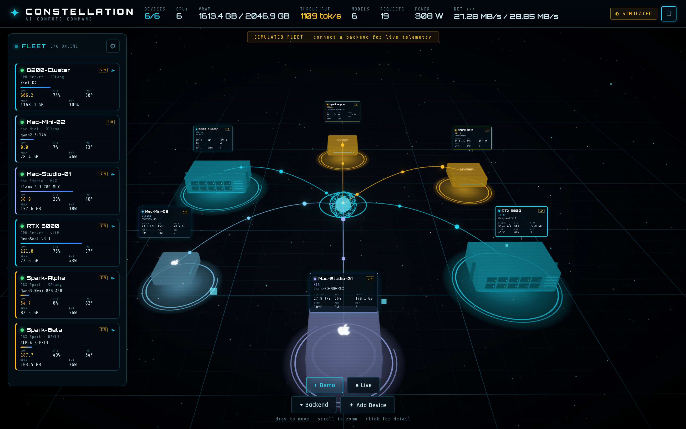
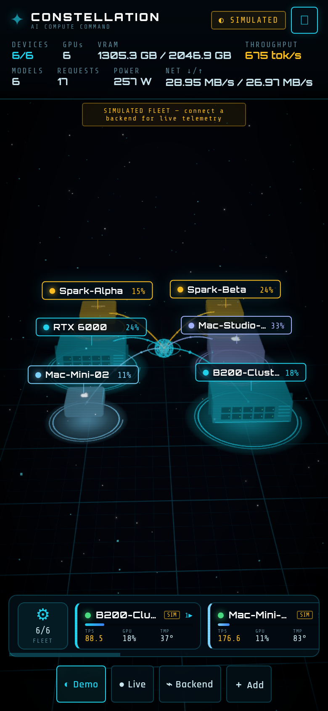

<div align="center">

# ✦ CONSTELLATION

### AI Compute Command Center

*Every device a star — linked into one constellation.*

A futuristic, TRON-inspired **3D observability dashboard** for your GPU fleet. Real machines
are collected over **SSH / Tailscale** and streamed live into holographic, hardware-accurate
device models with floating HUDs, a live fleet roster, and per-device charts.

[](https://vcruz305.github.io/constellation/)


**[▶ Open the live demo](https://vcruz305.github.io/constellation/)** — a clearly-labeled simulated fleet, no setup required.

</div>

<p align="center">
  
</p>
<p align="center">
  
</p>

---

## What it does

- **3D holographic fleet** — translucent, glowing models of **NVIDIA DGX Sparks, Mac Minis,
  Mac Studios, and rack GPU servers**, modeled to real device proportions (no generic boxes),
  arranged around a central command core on a TRON grid with animated telemetry links and
  drifting particles. **Drag to orbit, scroll to zoom, drag-and-drop** devices to reposition;
  click any device for a detailed inspector with live charts.
- **Live fleet roster** — an always-visible deck of per-device cards (status, engine, model,
  TPS, GPU %, VRAM, temperature, power). Desktop gets a left rail; phones get a swipeable
  strip; selecting a device in 3D auto-scrolls its card into view.
- **Real connectivity** — add unlimited devices over **SSH / local IP / Tailscale**, with
  automatic Tailscale node discovery. Detects hardware, GPUs, OS, processes, and inference
  servers across **Linux, macOS, NVIDIA CUDA, and Apple Silicon**.
- **Live inference monitoring** — auto-detects **vLLM, SGLang, llama.cpp, Ollama, MLX, and
  OpenAI-compatible servers (EXL3 / REXL3 / custom)** via real `/v1/models` and Prometheus
  `/metrics` endpoints, through an extensible adapter layer.
- **Per-device HUD + inspector** — model, engine, endpoint, decode TPS (**per-request and
  aggregate**, shown separately), prefill TPS, TTFT, active/queued requests, context, KV-cache,
  GPU/CPU util, VRAM, RAM, temperature, power, IP/Tailscale address, ports, uptime, and status.
- **Fleet dashboard** — aggregated GPUs/VRAM, combined throughput, active models, requests,
  power, network traffic, and device health in the header strip.
- **Scene settings** — a gear opens **13 live visualization controls** and **4 color themes**
  (see below). **Synthesized ambient + UI sound** with a single top-level mute.
- **Mobile-ready** — responsive layout, touch orbit, bottom-sheet panels, portrait/landscape
  arrangements, and safe-area-aware spacing.
- **2–5 s refresh** over WebSocket. **Never fabricates measurements** — unavailable metrics
  render `N/A`. A clearly-labeled **Demo mode** provides a simulated fleet.

## The interface

| Region | What it holds |
|---|---|
| **Header** | ✦ wordmark, mode badge (SIMULATED / LIVE), connection badge, aggregated fleet stats, and the 🔊 sound mute. |
| **Fleet roster** | One card per device with live metrics; the **⚙ gear** opens scene settings. |
| **3D scene** | The constellation itself — orbit / zoom / drag devices, click to inspect. |
| **Device inspector** | Full per-device hardware + inference detail with live charts (bottom sheet on mobile). |
| **Toolbar** | **Demo / Live** mode, **⌁ Backend** connect, **＋ Add Device**. |

### Scene settings & themes

The **⚙ gear** opens a settings sheet with live controls, grouped:

- **Render** — Glow (bloom), Quality (low/med/high), Hologram, Grid.
- **Motion** — Auto-orbit, Orbit speed, Flow speed, Particles.
- **Scene** — Telemetry links, **Theme**, plus **⟲ reset camera**, **⚄ shuffle layout**,
  **⤓ export PNG**, and **Reset all**.

Four committed palettes recolor the environment and UI (device identity colors stay semantic):
**Command** (cyan), **Reactor** (ember), **Biome** (aurora green), **Nebula** (violet).

## Architecture

```
frontend/   React 18 + Three.js (react-three-fiber) + postprocessing bloom, Zustand, Recharts
backend/    Python FastAPI + WebSocket, async SSH collectors, modular inference adapters
```

- The **frontend** is a static site (GitHub Pages). The public demo runs a built-in
  **simulated fleet** and **never prefills or auto-connects to anyone's backend**. Self-hosted
  builds (the backend serving the frontend) auto-link to their own origin.
- The **backend** runs on a host with SSH access to your devices. It executes a lightweight
  remote probe (`remote_probe.py`) on each device, parses real system/GPU/inference telemetry,
  computes rates, and broadcasts a fleet frame every 3 s over `/ws`.
- **Credentials stay server-side** (`devices.json`, mode `0600`); the browser only ever sees
  non-sensitive connection metadata. SSH key material is referenced by path, never copied.

### Data honesty
- Real metrics come only from `nvidia-smi`, `/proc`, `system_profiler`, and live inference
  endpoints. Anything unavailable is `null` → rendered **N/A**.
- Demo devices are flagged `demo: true` and badged **SIMULATED** everywhere.
- Per-request decode TPS is shown separately from aggregate throughput.
- Switching to **Live** with no backend configured shows **"No devices configured"** — it never
  presents the simulated fleet as if it were real.

## Run it

### Backend
```bash
cd backend
python3 -m venv .venv && . .venv/bin/activate
pip install fastapi "uvicorn[standard]" websockets
./run.sh                      # serves API + WS + built frontend on :8090
```
Add a device (SSH key/agent access must already work from this host):
```bash
curl -X POST localhost:8090/api/devices -H 'Content-Type: application/json' \
  -d '{"name":"gpu-node-01","kind":"auto","connection":{"type":"ssh","host":"gpu-node-01"}}'
```
Or use the in-app **＋ Add Device** dialog (with Tailscale discovery).

### Frontend (dev)
```bash
cd frontend && npm install && npm run dev
```

### Expose over HTTPS (Tailscale)
```bash
tailscale serve --bg 8090     # tailnet-only HTTPS at https://<host>.<tailnet>.ts.net
```
The app is then served same-origin at that URL. For public internet access, enable Tailscale
**Funnel** in the tailnet admin console and `tailscale funnel --bg 8090`.

> GitHub Pages is HTTPS, so the browser blocks a plain `http://<ip>` backend (mixed content).
> Use Tailscale Serve/Funnel (valid certificates) or another HTTPS host.

### Connect the hosted frontend to your backend
The public demo deliberately starts with **no backend prefilled** and shows the simulated
fleet. To monitor your own machines:
1. Run the backend (above) and add your devices server-side.
2. Expose it over HTTPS (Serve/Funnel).
3. In the app, press **⌁ Backend**, paste the HTTPS URL, and **Connect** — or press **● Live**,
   then **Connect Backend** from the empty fleet. The connect dialog includes these same steps.

SSH keys/credentials stay on the backend server and are never sent to the browser.

## Deploy to GitHub Pages
```bash
cd frontend && npm run deploy   # builds + pushes dist to gh-pages
```

## Notes
- GB10 / Apple Silicon use **unified memory**, so discrete VRAM is reported `N/A` (honest).
- Inference metrics appear only while a server is actually running; the adapter reads them live
  (e.g. SGLang `gen_throughput`, `num_running_reqs`, KV-cache usage).
- Scene preferences (visualization, theme, sound, device positions) persist in `localStorage`.